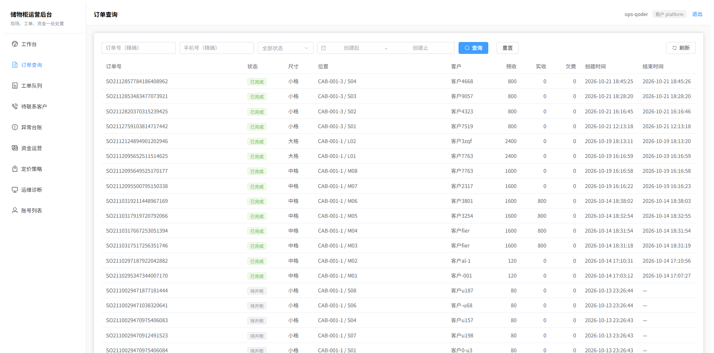
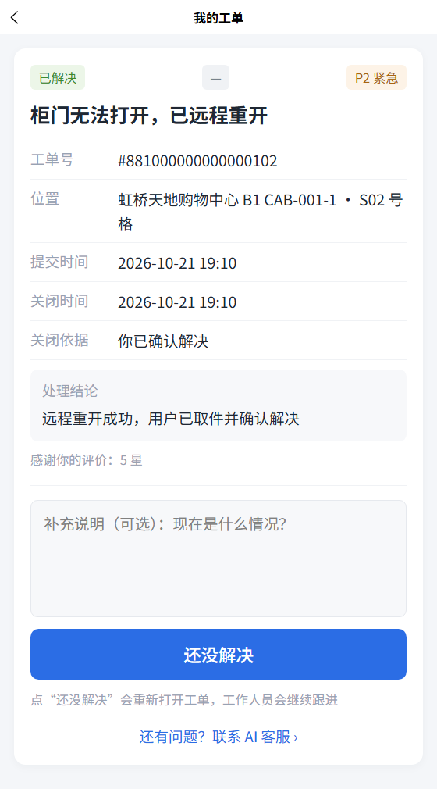

# 智慧寄存柜 SaaS

面向商场、车站、景区的多租户寄存系统。用户在手机上找柜、存件、取件，运营人员在后台处理订单、资金和异常工单。

本仓库（Cjagent）包含后端服务、运营后台和用户端三部分：后端使用 Java 与 Spring Boot，运营后台使用 Vue 3，用户端使用 uni-app，同时面向 H5 和微信小程序。

[](https://github.com/WhereLee/Cjagent/actions/workflows/ci.yml)

## 界面预览

运营后台：订单查询、工单队列、异常台账、资金运营、定价与账号权限。



用户端：查看附近点位与余位，存件取件；问题未解决可以转人工工单，解决后可以评价。



## 它解决什么问题

- **用户找柜**：先看附近点位的余位，再决定去哪里；扫码存件，按实际存放时长结算。
- **异常有出口**：门打不开、门没关好、格口里有别人的东西、取件码用不了，都能在手机上求助，必要时转给人工。
- **运营有台面**：待处理工单、异常格口、欠费与押金、订单流水集中在一个后台，按优先级和时限跟进。
- **平台可复制**：一套服务支撑多个租户，点位、柜机、格口和业务数据彼此隔离；设备异常可以本地复现，不依赖真机。

## 主要功能

**用户端**

- 按点位找柜，查看大、中、小格余位
- 存件开门、按小时计费、取件结算，多退少补
- 取件码取件，异常时远程重开门
- AI 客服处理账单、开门、取件问题，解决不了转人工工单
- 工单进度、重新打开，解决后做一次评价

**运营后台**

- 工单队列：分诊、优先级、责任组、SLA、等待用户、评价
- 订单查询与详情：按订单号、手机号、状态和时间筛选
- 异常台账：门未关、物品遗留、设备故障的处置与留痕
- 资金运营：欠费、未退押金、账户流水
- 定价策略、账号与权限

**平台能力**

- 多租户隔离：租户、点位、柜机、格口、订单、工单各归其位
- 设备通道：本地模拟超时、错报、离线、传感器异常等十余种故障，接真机只需替换通道实现
- AI：客服、工单简报、运维诊断三个对话 Agent，另有遗留物识图复审
- 运维诊断页：服务健康、错误日志、GC 与最近故障，集中在后台一页

## 技术栈

Java 17 · Spring Boot 3.5 · MyBatis-Plus · Flyway · Spring Security + JWT · MySQL 8 · Redis · RocketMQ 5 · Spring AI

Vue 3 + TypeScript + Vite + Element Plus（运营后台）· uni-app（用户端）

## 系统组成

```text
server/   后端：平台基础、身份、寄存、资金、工单、通知、设备、AI
admin/    运营后台
mini/     用户端（H5 / 微信小程序）
scripts/  本地环境、种子数据、冒烟与 AI 评测
stress/   压测计划与结果
deploy/   部署与 JVM 参数
ci/       CI 用中间件配置
```

后端按业务能力拆分模块，业务接口只通过 admin、mini 两组 BFF 暴露；模块之间走接口协作，不直接依赖彼此的实现。

## 快速开始

前置：JDK 17、Maven、Node.js 20+、MySQL 8、Redis、RocketMQ 5。

```powershell
# 1. 启动本地中间件（以端口监听和 redis PING 为准）
powershell -ExecutionPolicy Bypass -File scripts\dev-env.ps1

# 2. 准备配置（.env 已在 .gitignore 内）
copy server\.env.example server\.env
# 填写 MYSQL_* 账号口令、JWT_SECRET（HS256 ≥ 32 字节）

# 3. 建库，表结构由 Flyway 在启动时创建
mysql -u root -p -e "create database if not exists cabinet_dev character set utf8mb4;"

# 4. 启动后端
powershell -ExecutionPolicy Bypass -File scripts\run-app.ps1
curl.exe -s http://127.0.0.1:8080/api/system/health

# 5. 运营后台
cd admin
npm ci
npm run dev        # http://localhost:8082

# 6. 用户端 H5
cd ../mini
npm ci
npm run dev:h5     # http://localhost:8083
```

- 接口文档：<http://127.0.0.1:8080/swagger-ui.html>（分组 `0-system` / `1-admin` / `2-mini`）
- 后台账号不预置，首次部署后需要先创建账号并分配权限，仓库里不保留可用口令。
- 本地 `dev` 配置开启小程序 mock 登录：任意 code 都能完成登录，首次注册需要带租户编码和手机号。
- 点位、柜机、格口的示例数据由 `scripts/seed-locker.mjs` 生成 SQL，按脚本末尾的提示导入。

## 测试与质量

```powershell
cd server
mvn -B -ntp test                # 单元测试，不依赖中间件
mvn -B -ntp test -Pintegration  # 集成测试，需要真实中间件
```

前端各自有 lint、类型检查和构建命令，CI 会一起跑：

```powershell
cd admin
npm run lint
npm run build

cd ../mini
npm run lint
npm run typecheck
npm run build:h5
```

- 接口契约有快照测试，前端类型由 OpenAPI 生成，契约变化会在 CI 暴露。
- AI 回复有一套离线金问题集，用 `scripts/ai-eval.ps1` 手动执行，CI 不调用付费模型。
- 设备故障、资金流水、工单状态这些关键路径都有集成用例覆盖。

## 项目边界

- 个人项目，用于学习与展示；仓库里的数据是本地演示数据，不代表真实运营情况。
- 设备为进程内模拟通道，定位是可复现的异常源，不做物理设备还原。
- 支付通道尚未接入真实渠道，充值在本地走模拟实现。
- 仓库不包含生产密钥、内网地址和运维手册。

## License

个人项目，保留所有权利。未经许可，不得用于商业用途。
